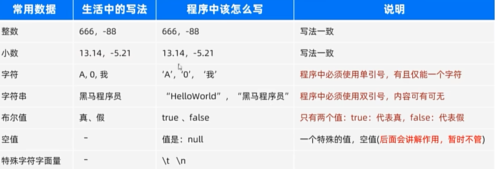
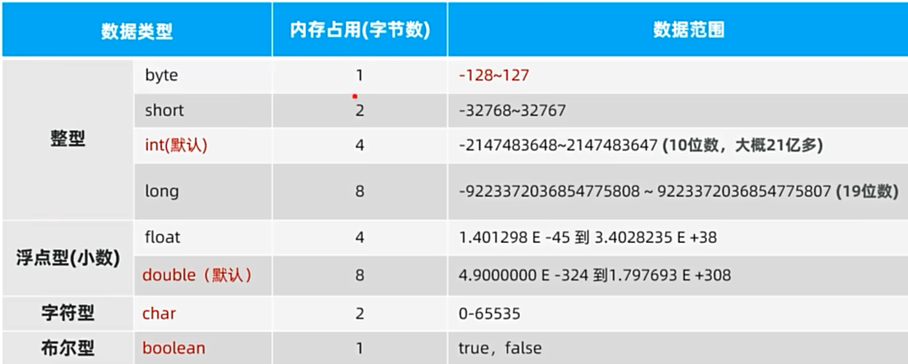

#  注释
## Java 注释
 1. 单行注释：//
2. 块注释 /* */
3. 文档注解 /** */


# 字面量




# 变量
 就是内存中的一块区域，用来存储数据。


## 变量命名规则
1. 变量名必须由字母、数字、下划线、$组成，且不能以数字开头。
2. 变量名区分大小写，例如：name 和 Name 是两个不同的变量名。
3. 变量名不能使用关键字和保留字，如 public、class 等。
4. 变量名应该简洁明了，尽量做到见名知意。
5. 驼峰式命名法：第一个单词小写，后面的每个单词首字母大写。例如：userName、userAge

## 变量定义格式
 数据类型 变量名 = 值;
```java
int a = 10;
String name = "hello";
boolean flag = true;
double d = 3.14;
```

## 变量里数据的存储原理

二进制：0、1，计算机底层都是二进制，逢2加1。 
10进制转2进制：除2取余数，再倒序输出。

计算机找那个表述数据的最小单位
1字节(byte)：8bit(8个二进制位)   1B = 8b

* 1KB = 1024B
* 1MB = 1024KB
* 1GB = 1024MB
* 1TB = 1024GB


存储
* 文本，字符串-》二进制
* 图片-》二进制
* 音、视频-》二进制


## 数据类型
1. 基本数据类型：byte、short、int、long、float、double、char、boolean
2. 引用数据类型：类、接口、数组




## 例子
写出一个for循环打印 1 到 10 的数字
```java
for (int i = 1; i <= 10; i++) {
    System.out.println(i);
}
```

## 练习
根据用户输入的成绩判断等级（90 分及以上为 A，80 - 89 分为 B，70 - 79 分为 C，60 - 69 分为 D，60 分以下为 E）
```java
import java.util.Scanner;

public class GradeChecker {
    public static void main(String[] args) {
        Scanner scanner = new Scanner(System.in);
        System.out.println("请输入成绩:");
        int score = scanner.nextInt();

        // 使用 if - else 语句判断等级
        if (score >= 90) {
            System.out.println("A");
        } else if (score >= 80) {
            System.out.println("B");
        } else if (score >= 70) {
            System.out.println("C");
        } else if (score >= 60) {
            System.out.println("D");
        } else {
            System.out.println("E");
        }

        // 使用 switch - case 语句判断等级（需先对成绩进行处理，使其符合 switch - case 的等值判断要求）
        int level = score / 10;
        switch (level) {
            case 10:
            case 9:
                System.out.println("A");
                break;
            case 8:
                System.out.println("B");
                break;
            case 7:
                System.out.println("C");
                break;
            case 6:
                System.out.println("D");
                break;
            default:
                System.out.println("E");
                break;
        }
        scanner.close();
    }
}
```
### 代码解释
在 Java 中，Scanner是 Java 提供的一个用于获取用户输入的类，它位于java.util包中 。以下详细介绍：

> 作用：Scanner类主要用于解析基本类型和字符串。它允许程序从多种输入源读取数据，包括标准输入（键盘输入）、文件输入等 。例如，当你需要获取用户在控制台输入的数字、字符串等信息时，就可以使用Scanner类。
* System.in代表标准输入流，即键盘输入
* nextInt()：用于读取一个整数。例如，int num = scanner.nextInt(); 程序执行到这一行时，会等待用户在控制台输入一个整数，输入完成并按下回车键后，输入的整数就会被赋值给num变量
* 在 Java 中，当两个整数进行除法运算时，结果会取整数部分，不会进行四舍五入 


